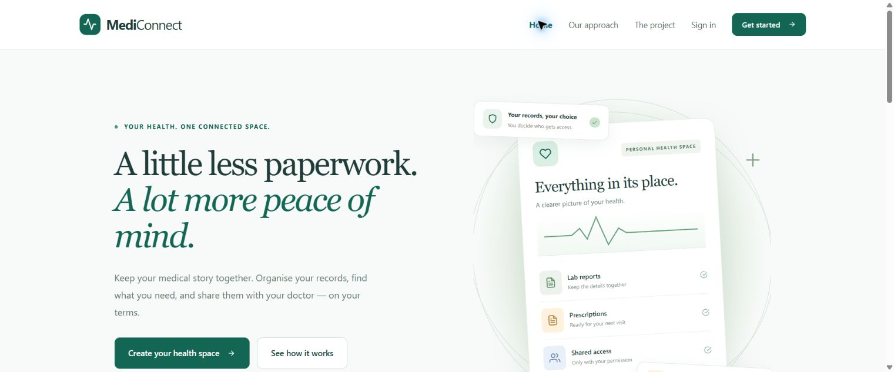
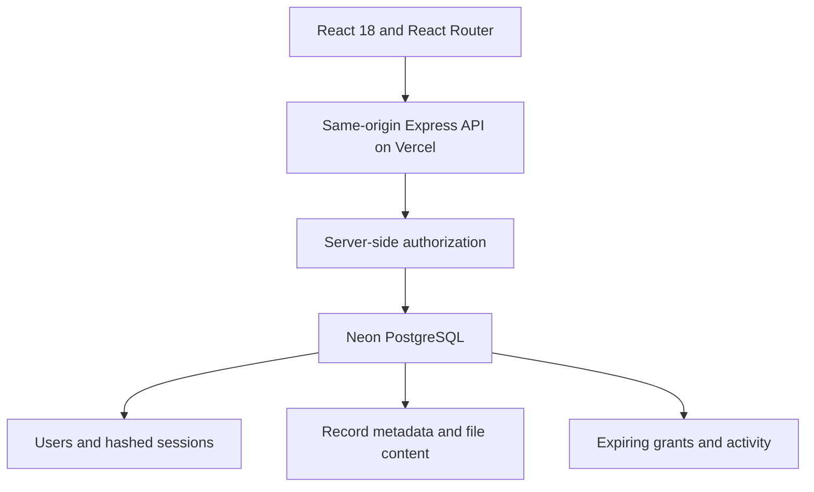

# MediConnect

[Open the live website](https://mediconnect-psi-sand.vercel.app)



**Patient-controlled health record sharing.** An academic full-stack project by Kushagra Pandey and team.

MediConnect addresses fragmented medical documents: patients upload and organise their records, then explicitly grant a specific doctor time-limited read access. A patient code identifies an account; it does **not** authorize access.

> Use synthetic data only. This is an academic showcase, not a certified clinical product. It is inspired by connected healthcare/UHI concepts; it does not call UHI/ABDM APIs, generate ABHA IDs, verify practitioners, or provide medical advice.

## User walkthrough

### Accounts

Register as a patient or doctor. Save the recovery key displayed after signup in a password manager. Existing users can generate a key in **Account** after confirming their password. **Forgot your password?** accepts your email, saved key and a new password, invalidates existing sessions and issues a replacement key.

**Account** supports name editing, password changes, active-session descriptions and signing out all devices. Password changes sign out all sessions. Email delivery requires a configured verified sender; it is currently unavailable on the public deployment. Email verification does not verify medical qualifications.

### Patient records

Use **Add a record** for PDF, JPEG or PNG documents up to 2 MB, with a title, category and date. The limit remains 30 documents per patient. Search/filter the library, preview or download the original document, edit its title/category/date, or delete it with confirmation. Use synthetic records only.

### Sharing and approval

1. A doctor opens **Access requests**, enters the patient's account code and a short reason, and sends a request. Sending a request gives no access.
2. The patient opens **Sharing & access** and refreshes the request list.
3. The patient reviews the doctor's name, email, code and purpose, then chooses **Deny** or **Review & choose records**.
4. Approval requires selected documents and an expiry: 1 hour, 6 hours, 24 hours, 3 days or 7 days.
5. The doctor refreshes **Shared patients** and opens the approved library. Only selected documents are listed; new uploads remain private.
6. The patient can revoke permission at any time. Every subsequent preview/download checks the live permission. Copies already displayed or downloaded cannot be recalled.

Patients can also initiate sharing by entering a doctor's code, reviewing the recipient and selecting documents. New approvals replace that doctor's previous scope. Existing whole-library grants are labelled as legacy permissions until expiry or revocation. Requests expire after seven days. Doctor roles remain self-declared.

### Activity and appearance

The patient Activity tab shows the latest 30 record and permission events. Light/dark mode follows the system initially and saves a manual preference in the browser. Both themes use static gradients.

## Project scope

MediConnect is a UHI-inspired academic prototype focused on connected patient/doctor workflows and explicit patient approval. Local account codes and permissions are not ABHA identifiers or ABDM consent artefacts. No UHI or ABDM network API is connected. There is no booking, billing, clinical advice or verified practitioner registry integration.

## Architecture and stack



The original project used local MongoDB, Google Drive and Create React App. The obsolete build toolchain was replaced by Vite without changing the React framework. The deployed revision retains **React and Express**, and uses a dedicated free Neon PostgreSQL database through the Vercel integration. No existing MongoDB data is migrated or deleted. The current stack is React + Express + PostgreSQL.

For this bounded showcase, small files are stored as base64 content in the database. This avoids public medical file URLs and an additional storage service. Base64 adds approximately 33% storage overhead; a larger deployment should stream files from private object storage and retain metadata in the database.

### Code map

| Path                            | Responsibility                                           |
| ------------------------------- | -------------------------------------------------------- |
| `front-end/src/App.jsx`         | Application shell, session bootstrap, routing            |
| `front-end/src/Home.jsx`        | Public landing page                                      |
| `front-end/src/AuthPage.jsx`    | Registration and login                                   |
| `front-end/src/Dashboard.jsx`   | Patient and doctor workflows                             |
| `front-end/src/UploadModal.jsx` | Upload form and validation feedback                      |
| `front-end/src/shared.jsx`      | Reusable record list, modal and UI helpers               |
| `back-end/server.js`            | Express API, authorization, validation and rate limits   |
| `back-end/security.js`          | Salted scrypt password hashing and file signatures       |
| `back-end/db.js`                | Lazy database connection and idempotent schema bootstrap |
| `api/index.js`                  | Vercel function entry point                              |
| `tests/`                        | Security checks and end-to-end regression scripts        |

## Run locally

Requires Node.js 24 and a PostgreSQL database accessible via the Neon HTTP driver.

```bash
git clone https://github.com/kushagrapandey-cmd/mediconnect.git
cd mediconnect
npm ci
npm --prefix front-end ci
cp .env.example .env.local
# Set DATABASE_URL privately in .env.local; never commit it.
npm run build
node --env-file=.env.local back-end/server.js
# Open http://localhost:4000
```

The schema is created idempotently on the first API request. The server uses parameterized queries. It fails closed when the database is unavailable; there is no mock account or localStorage data fallback.

## Security decisions

- Passwords use random salts and asynchronous scrypt; plaintext passwords are never stored or returned.
- A random 256-bit session token lives in an HttpOnly, SameSite=Lax cookie (Secure on Vercel); only its SHA-256 hash is persisted. Sessions expire after seven days and logout invalidates the current token.
- The API validates data types and lengths, constrains roles, uses parameterized SQL and rejects cross-origin mutations.
- File access uses unpredictable record UUIDs plus owner/active-grant authorization, never filename lookup. Two identical filenames remain separate records.
- Uploads use memory storage with size limits and verify PDF/JPEG/PNG signatures. Signature checks are not antivirus scanning.
- Login, signup, uploads, sharing and doctor lookup have database-backed rate limits. The local development IP fallback is not intended as a reverse-proxy security boundary.
- Helmet supplies response security headers; authenticated responses are marked `no-store`.

## Tests

```bash
npm test
CI=true npm --prefix front-end run build
```

See `QA.md` for the final test evidence and limitations. End-to-end tests use synthetic accounts and should target an isolated development database.

## Limitations

Synthetic data only. Doctor roles are self-selected. Email verification and email password reset require sender configuration; recovery keys work independently. Account deletion remains a maintainer operation. The activity log is application history, not an immutable forensic audit trail. Current storage quotas are designed for a bounded academic showcase.

## Team

Kushagra Pandey — Development · Arun Kumar Shukla — Database · Prajjwal Kumar — Interface design · Prince Kumar Pal — Backend
