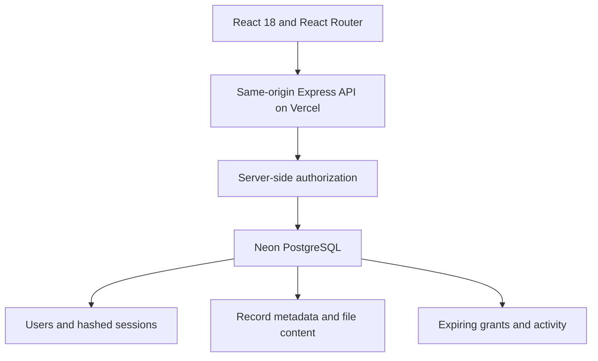

# MediConnect

**Patient-controlled health record sharing.** An academic full-stack project by Kushagra Pandey and team.

MediConnect addresses fragmented medical documents: patients upload and organise their records, then explicitly grant a specific doctor time-limited read access. A patient code identifies an account; it does **not** authorize access.

> Use synthetic data only. This is an academic showcase, not a certified clinical product. It is inspired by connected healthcare/UHI concepts; it does not call UHI/ABDM APIs, generate ABHA IDs, verify practitioners, or provide medical advice.

## Working features

- Patient and doctor registration/login, role-specific workspaces and refresh-persistent sessions.
- Upload PDF, JPEG and PNG records with title, category and date; maximum 2 MB per file and 30 records per patient.
- Search/filter records, download original bytes and delete owned documents with confirmation.
- Patient-issued grants for a specific doctor's code, valid for 24 hours and revocable immediately for future requests.
- Doctor view of consenting patients and their shared libraries; every read/download checks the current grant.
- Patient activity timeline covering uploads, downloads, views and permission changes.
- Responsive pages, keyboard navigation, native modal focus management and reduced-motion support.

## Architecture and stack



The original project used local MongoDB and Google Drive. The deployed revision retains **React and Express**, and uses a dedicated free Neon PostgreSQL database through the user's existing Vercel integration. No existing MongoDB data is migrated or deleted. Do not describe this revision as MERN: it is React + Express + PostgreSQL.

For this bounded showcase, small files are stored as base64 content in the database. This avoids public medical file URLs and an additional storage service. Base64 adds approximately 33% storage overhead; a larger deployment should stream files from private object storage and retain metadata in the database.

### Code map

| Path                           | Responsibility                                           |
| ------------------------------ | -------------------------------------------------------- |
| `front-end/src/App.js`         | Application shell, session bootstrap, routing            |
| `front-end/src/Home.js`        | Public landing page                                      |
| `front-end/src/AuthPage.js`    | Registration and login                                   |
| `front-end/src/Dashboard.js`   | Patient and doctor workflows                             |
| `front-end/src/UploadModal.js` | Upload form and validation feedback                      |
| `front-end/src/shared.js`      | Reusable record list, modal and UI helpers               |
| `back-end/server.js`           | Express API, authorization, validation and rate limits   |
| `back-end/security.js`         | Salted scrypt password hashing and file signatures       |
| `back-end/db.js`               | Lazy database connection and idempotent schema bootstrap |
| `api/index.js`                 | Vercel function entry point                              |
| `tests/`                       | Security checks and end-to-end regression scripts        |

## Run locally

Requires Node.js 22 or later and a PostgreSQL database accessible via the Neon HTTP driver.

```bash
git clone https://github.com/kushagrapandey-cmd/mediconnect.git
cd mediconnect
npm ci
npm --prefix front-end ci
cp .env.example .env.local
# Set DATABASE_URL privately in .env.local; never commit it.
npm run build
node --env-file=.env.local back-end/server.js
# Open http://localhost:4000
```

The schema is created idempotently on the first API request. The server uses parameterized queries. It fails closed when the database is unavailable; there is no mock account or localStorage data fallback.

## Interview demo: 4–5 minutes

1. In a normal window, register a patient with a synthetic name and test email.
2. Upload two synthetic PDFs with the same filename but different titles. Search/filter and download each to demonstrate ID-based retrieval.
3. In an incognito window, register a doctor. Copy the doctor code.
4. Before permission is granted, look up the patient code: access must fail.
5. From the patient window, open **Sharing & access** and grant access using the doctor code.
6. From the doctor window, open the patient's library and download a document.
7. Revoke the permission in the patient window. Another doctor request/download must fail.
8. Open the patient's Activity tab; show the access timeline, then delete a document with confirmation.
9. Refresh and log out/in to show persistence and session handling.

Use your own synthetic demo accounts instead of public shared credentials.

## Security decisions

- Passwords use random salts and asynchronous scrypt; plaintext passwords are never stored or returned.
- A random 256-bit session token lives in an HttpOnly, SameSite=Lax cookie (Secure on Vercel); only its SHA-256 hash is persisted. Sessions expire after seven days and logout invalidates the current token.
- The API validates data types and lengths, constrains roles, uses parameterized SQL and rejects cross-origin mutations.
- File access uses unpredictable record UUIDs plus owner/active-grant authorization, never filename lookup. Two identical filenames remain separate records.
- Uploads use memory storage with size limits and verify PDF/JPEG/PNG signatures. Signature checks are not antivirus scanning.
- Login, signup, uploads, sharing and doctor lookup have database-backed rate limits. The local development IP fallback is not intended as a reverse-proxy security boundary.
- Helmet supplies response security headers; authenticated responses are marked `no-store`.

## Tests

```bash
npm test
CI=true npm --prefix front-end run build
```

See `QA.md` for the final test evidence and limitations. End-to-end tests use synthetic accounts and should target an isolated development database.

## Honest limitations / future work

Doctor roles are self-selected for demonstration. There is no email verification, password recovery, administrative identity review, clinical validation, UHI/ABDM interoperability or regulatory certification. Account erasure is currently a maintainer operation. Revocation cannot recall downloaded copies. The activity log is an application history, not an immutable forensic audit trail. Per-account quotas and free-tier capacity are suitable for a bounded showcase, not an unrestricted public medical service.

Before clinical use: verified practitioners, consent policy review, encrypted private object storage with retention/deletion policy, malware scanning, backup/restore drills, dedicated migrations, operational monitoring, accessibility audit and a formal security/privacy review are needed.

## Team

Kushagra Pandey — Development · Arun Kumar Shukla — Database · Prajjwal Kumar — Interface design · Prince Kumar Pal — Backend
