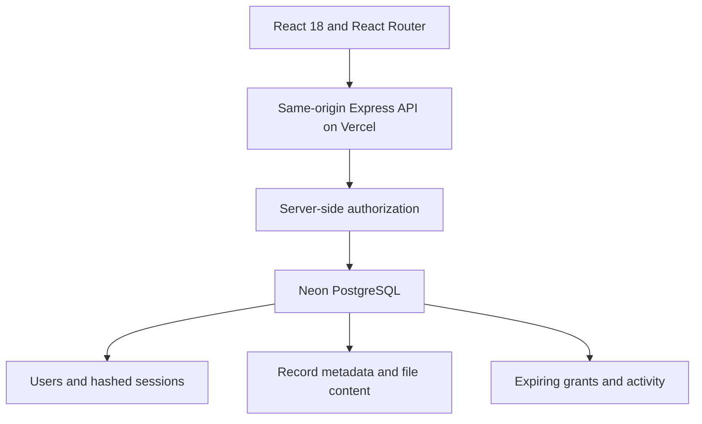

# MediConnect

[Open the live website](https://mediconnect-psi-sand.vercel.app)


**Patient-controlled health record sharing.** An academic full-stack project by Kushagra Pandey and team.

MediConnect addresses fragmented medical documents: patients upload and organise their records, then explicitly grant a specific doctor time-limited read access. A patient code identifies an account; it does **not** authorize access.

> Use synthetic data only. This is an academic showcase, not a certified clinical product. It is inspired by connected healthcare/UHI concepts; it does not call UHI/ABDM APIs, generate ABHA IDs, verify practitioners, or provide medical advice.

## Start here

- **Normal user:** read the complete walkthrough below. No code knowledge is required.
- **Developer/interview preparation:** [Engineering guide: GitHub, code flow and design choices](docs/ENGINEERING_GUIDE.md).
- **Your work versus AI assistance:** [Contribution evidence and research ledger](docs/CONTRIBUTIONS.md). Do not infer manual authorship from commit names.
- **Future/startup planning:** see the summary below and [detailed integration/business plan](docs/ROADMAP_AND_BUSINESS.md).
- **Record a public demo:** [LinkedIn recording guide](docs/DEMO_GUIDE.md).
- **Test evidence:** [QA report](QA.md).

## Normal user walkthrough — every current feature

### 1. Explore the public pages and choose a theme

Open **Home** for the idea, **Our approach** for patient/doctor roles, **The project** for the team/source link, and **Privacy & limitations** for storage/sharing boundaries. These pages do not require login. On a phone, use the menu button to reveal navigation.

The **Light / Dark** switch is always available in the header, including on mobile. First visit follows your system colour preference; a manual choice is saved in this browser and survives refresh/navigation. It synchronises between tabs on the same origin. If browser storage is blocked, the switch still works for the current visit, but saving it across reloads is not guaranteed. Both themes use static teal/blue/green gradients; there is no animation loop.

### 2. Create an account and sign in

1. Select **Get started**. Choose **I'm a patient** to own a library, or **I'm a doctor** to view records shared with you.
2. Enter a name (2–80 characters), a valid-format email and a password (10–128 characters). Use a test email and a unique synthetic/demo password. Email delivery/verification is not implemented.
3. Acknowledge that this is a synthetic-data academic prototype and submit. You are signed in automatically.
4. Your workspace shows a unique **10-character account code**. Copy it with **Copy code**, or select/copy the displayed text if clipboard permission is unavailable.
5. Later, use **Sign in** with email/password. The code is not an extra login password. Refreshing keeps a valid session; **Sign out** invalidates the current session.

Doctor selection is a demonstration role, not a verified medical qualification. Password reset, profile editing and self-service account deletion are not available. Contact the maintainer for account removal. The old local MongoDB accounts were not migrated; create a new account for this deployment.

### 3. Patient: use Overview and My records

**Overview** shows record count, active doctor permissions, the 24-hour sharing window and a recent-records preview. **View all** opens **My records**, which contains the complete library. The recent preview shows up to five records, so use the full library to search everything.

To add a record:

1. Click **Add a record**. If you need a safe demo file, use **Download a synthetic sample record** inside the dialog.
2. Choose one **PDF, JPEG or PNG**, up to **2 MB**. The screen uses a file picker, not a custom drag-and-drop implementation.
3. Add a document title (2–120 characters), choose **Lab report / Prescription / Imaging / Discharge summary / Other**, and choose its date. Future/impossible dates are rejected; supported dates start at 1900-01-01.
4. Click **Save record** and wait for confirmation. The library/count refreshes. The current showcase supports **30 documents per patient**; it is not unlimited storage.
5. Use **Search records** to match title, original filename or category within the currently shown list. The category dropdown narrows it further. Clear search and select **All records** to reset.
6. Click the download icon next to a record to download the original file. There is no built-in clinical interpretation or document editing.
7. Click the delete icon, then **Delete document** only if you want to remove it permanently from the active library. **Keep document**, Close or Escape cancels. Deletion leaves an activity entry; provider backup retention is separate.

Two files can have the same filename: records use separate IDs. Patient-uploaded titles/categories are not verified clinical facts. A preview request, invalid type, oversized file or service failure shows an error; do not assume a file was saved until confirmation appears.

### 4. Patient: grant, renew or revoke doctor access

1. Ask the doctor to register a separate doctor account and give you **their doctor code**.
2. Open **Sharing & access**, enter that code and choose **Grant access**.
3. The doctor can now **read and download your entire library for 24 hours**, including new uploads during the grant. They cannot delete your records.
4. **Active permissions** shows the doctor and expiry. Granting the same doctor again renews the pair's expiry from that new grant; it does not create another independent permission.
5. Choose **Revoke access** to block subsequent server requests immediately. An already visible list may remain on a doctor's screen; their next access/download is checked again. Copies downloaded earlier cannot be recalled.

There is no patient-code-only access, no automatic public sharing, and no per-document sharing switch yet. A doctor account cannot grant itself access.

### 5. Doctor: open a consenting patient's library

1. Sign in with a **doctor** account. Copy the doctor code from Overview and share it with the patient.
2. The patient completes the grant above. Refresh/reopen the workspace if it was already open before the grant.
3. **Overview / Shared patients** lists patients with active permissions. Click a patient, or enter the patient's code under **Find shared records**.
4. View the shared read-only library, search/filter the shown records and download a file.
5. If access is absent, revoked or expired, the server denies the request. Knowing the patient code or record ID does not bypass permission.

The current doctor workspace does not create prescriptions, upload into a patient's account, schedule appointments or conduct consultations.

### 6. Patient: inspect Activity

**Activity** shows the latest **30** recorded uploads, downloads, doctor views and grant/revoke changes, with the actor and time. It is application history, not an immutable forensic audit log. Dates/times display using your browser's local timezone.

### 7. Understand common errors and boundaries

| Situation                                 | What to do                                                                                                                         |
| ----------------------------------------- | ---------------------------------------------------------------------------------------------------------------------------------- |
| Email already registered                  | Use Sign in. There is no password-recovery flow today.                                                                             |
| Invalid code / doctor cannot find patient | Check role/code and have the patient grant permission to that exact doctor.                                                        |
| Search shows no results                   | Clear the query/category; open My records rather than only the recent preview.                                                     |
| File rejected                             | Check supported type, real file signature, 2 MB limit, title and date. Renaming an executable to `.pdf` will not make it accepted. |
| Upload limit reached                      | Remove a document you no longer need; current cap is 30.                                                                           |
| Too many attempts                         | Wait for the stated 15-minute rate-limit window; do not repeatedly resubmit.                                                       |
| Expired session                           | Sign in again.                                                                                                                     |
| Service/network error                     | Retry after checking connectivity; do not treat the operation as complete without its success state.                               |

No real UHI/ABDM integration, verified practitioner onboarding, booking, payments, email delivery, AI diagnosis or medical advice is present. The public source and synthetic demo are appropriate for software evaluation; real patient records need the separate readiness work described below.

## Working features

- Patient and doctor registration/login, role-specific workspaces and refresh-persistent sessions.
- Upload PDF, JPEG and PNG records with title, category and date; maximum 2 MB per file and 30 records per patient.
- Search/filter records, download original bytes and delete owned documents with confirmation.
- Patient-issued grants for a specific doctor's code, valid for 24 hours and revocable immediately for future requests.
- Doctor view of consenting patients and their shared libraries; every read/download checks the current grant.
- Patient activity timeline covering uploads, downloads, views and permission changes.
- Responsive pages, keyboard navigation, native modal focus management and reduced-motion support.
- Light/dark theme switch with saved browser preference and static medical-style gradients.
- Vite production build, with a small dependency tree and optimized team portraits.

## Architecture and stack



The original project used local MongoDB, Google Drive and Create React App. The obsolete build toolchain was replaced by Vite without changing the React framework. The deployed revision retains **React and Express**, and uses a dedicated free Neon PostgreSQL database through the user's existing Vercel integration. No existing MongoDB data is migrated or deleted. Do not describe this revision as MERN: it is React + Express + PostgreSQL.

For this bounded showcase, small files are stored as base64 content in the database. This avoids public medical file URLs and an additional storage service. Base64 adds approximately 33% storage overhead; a larger deployment should stream files from private object storage and retain metadata in the database.

### Code map

| Path                            | Responsibility                                           |
| ------------------------------- | -------------------------------------------------------- |
| `front-end/src/App.jsx`         | Application shell, session bootstrap, routing            |
| `front-end/src/Home.jsx`        | Public landing page                                      |
| `front-end/src/AuthPage.jsx`    | Registration and login                                   |
| `front-end/src/Dashboard.jsx`   | Patient and doctor workflows                             |
| `front-end/src/UploadModal.jsx` | Upload form and validation feedback                      |
| `front-end/src/shared.jsx`      | Reusable record list, modal and UI helpers               |
| `back-end/server.js`            | Express API, authorization, validation and rate limits   |
| `back-end/security.js`          | Salted scrypt password hashing and file signatures       |
| `back-end/db.js`                | Lazy database connection and idempotent schema bootstrap |
| `api/index.js`                  | Vercel function entry point                              |
| `tests/`                        | Security checks and end-to-end regression scripts        |

## Run locally

Requires Node.js 24 and a PostgreSQL database accessible via the Neon HTTP driver.

```bash
git clone https://github.com/kushagrapandey-cmd/mediconnect.git
cd mediconnect
npm ci
npm --prefix front-end ci
cp .env.example .env.local
# Set DATABASE_URL privately in .env.local; never commit it.
npm run build
node --env-file=.env.local back-end/server.js
# Open http://localhost:4000
```

The schema is created idempotently on the first API request. The server uses parameterized queries. It fails closed when the database is unavailable; there is no mock account or localStorage data fallback.

## Interview demo: 4–5 minutes

1. In a normal window, register a patient with a synthetic name and test email.
2. From **Add a record**, download the included synthetic sample PDF. Upload it twice with the same filename but different titles. Search/filter and download each to demonstrate ID-based retrieval.
3. In an incognito window, register a doctor. Copy the doctor code.
4. Before permission is granted, look up the patient code: access must fail.
5. From the patient window, open **Sharing & access** and grant access using the doctor code.
6. From the doctor window, open the patient's library and download a document.
7. Revoke the permission in the patient window. Another doctor request/download must fail.
8. Open the patient's Activity tab; show the access timeline, then delete a document with confirmation.
9. Refresh and log out/in to show persistence and session handling.

Use your own synthetic demo accounts instead of public shared credentials.

## Security decisions

- Passwords use random salts and asynchronous scrypt; plaintext passwords are never stored or returned.
- A random 256-bit session token lives in an HttpOnly, SameSite=Lax cookie (Secure on Vercel); only its SHA-256 hash is persisted. Sessions expire after seven days and logout invalidates the current token.
- The API validates data types and lengths, constrains roles, uses parameterized SQL and rejects cross-origin mutations.
- File access uses unpredictable record UUIDs plus owner/active-grant authorization, never filename lookup. Two identical filenames remain separate records.
- Uploads use memory storage with size limits and verify PDF/JPEG/PNG signatures. Signature checks are not antivirus scanning.
- Login, signup, uploads, sharing and doctor lookup have database-backed rate limits. The local development IP fallback is not intended as a reverse-proxy security boundary.
- Helmet supplies response security headers; authenticated responses are marked `no-store`.

## Tests

```bash
npm test
CI=true npm --prefix front-end run build
```

See `QA.md` for the final test evidence and limitations. End-to-end tests use synthetic accounts and should target an isolated development database.

## Contribution and learning

The original React/Express/Mongoose/Google Drive project existed before this upgrade. Kushagra requested and directed a substantial **ChatGPT/Codex-assisted refactor**. The assistant implemented the current redesign, authentication/authorization refactor, database/deployment changes, automated QA, themes and this documentation. Original person-by-person code ownership and research interviews were not independently verified. Connected-account Git commit names do not prove manual authorship.

Read [CONTRIBUTIONS.md](docs/CONTRIBUTIONS.md) for the evidence, safe interview wording, a worksheet for your actual research/original contributions, and what you should personally learn before presenting it. Read [ENGINEERING_GUIDE.md](docs/ENGINEERING_GUIDE.md) for request flows, database tables, API map, architecture choices/tradeoffs and interview questions.

## Future integration plan

The next steps are proposals, not live capabilities:

1. **Product reliability:** account recovery/verification, practitioner review, document-level sharing, atomic quotas/mutations, private object storage, retention/deletion, backup restores and operational monitoring.
2. **Validate one workflow:** interview clinic staff about collecting/retrieving reports before follow-up visits; test a visit-linked document inbox before attempting a nationwide all-in-one product.
3. **ABDM records track:** confirm the relevant sandbox role/milestones, patient/provider linkage, consent exchange, appropriate HIP/HIU capabilities and validated FHIR documents. The current local account code/grant is not ABHA or an ABDM consent artefact.
4. **UHI services track:** choose one eligible service and the EUA/HSPA role, complete current onboarding prerequisites, implement signed requests, asynchronous callbacks and transaction handling, then test the supported booking/cancellation lifecycle before seeking production access.
5. **Pilot and commercialise:** only after readiness, validate recurring usage, support cost, willingness to pay and renewal. Sandbox access, a deployed UI and a pricing table are not evidence of a functioning startup.

UHI handles health-service discovery/delivery, whereas HIE-CM handles consent-based record exchange; FHIR provides interoperable health-document profiles. See the [official sources and detailed integration plan](docs/ROADMAP_AND_BUSINESS.md#official-technical-sources). Requirements/service capabilities can change; reconfirm them during onboarding.

## Possible business and money models

**Recommendation:** first test a small-clinic subscription for a narrow, useful document workflow. PDFs in a portal alone are not a defensible business. All prices below are **hypothetical willingness-to-pay tests**, not current offers, market quotes or revenue forecasts.

| Model                       | Buyer/value to validate                                              | Illustrative experiment                          | Main challenge                                     |
| --------------------------- | -------------------------------------------------------------------- | ------------------------------------------------ | -------------------------------------------------- |
| Clinic SaaS subscription    | Clinic pays for staff time saved and reliable visit-linked retrieval | ₹999–₹2,499/clinic/month                         | Repeat usage, tenant isolation, support cost       |
| Setup/training/migration    | Clinic/lab pays for a defined implementation service                 | ₹2,000–₹10,000 once                              | Labour intensity; not recurring software revenue   |
| Lab workflow SaaS           | Lab pays for report delivery/retrieval workflow                      | Monthly versus volume-based pilot quote          | Existing systems and reliable patient matching     |
| White-label portal          | Network/NGO pays for branding, workflow and support                  | Scoped paid pilot                                | Customisation, sales cycle and service obligations |
| Patient/family premium      | Optional convenience, organisation or storage                        | Test ₹49–₹149/family/month                       | Free alternatives, retention and acquisition cost  |
| B2B integration/API service | Vendor pays for a real supported integration                         | Development + support/usage contract             | Interoperability must work before selling it       |
| Booking facilitation fee    | Disclosed service fee where the chosen programme permits it          | Test only after actual booking/payment readiness | No automatic right to charge because UHI is open   |
| Organisational sponsorship  | NGO/employer funds a consent-based workflow                          | Bounded pilot contract                           | Paying does not confer access to members' records  |
| Assisted organisation       | Non-clinical onboarding/document organisation                        | Fixed fee for a clear task                       | Trust, permissions and labour cost                 |

Example arithmetic, **not a forecast**: ten clinics actually paying ₹1,499/month would produce ₹14,990 gross MRR. If direct servicing cost were ₹400/clinic, contribution before fixed costs would be ₹10,990. Salaries, engineering, audits, legal/accounting, tax, refunds and churn still need budgeting. We have not established paying customers or that cost assumption.

Do not build the business around selling identifiable patient data. Government incentives are not assumed revenue. Detailed legality/compliance analysis is deferred as requested; a real-data or paid launch still needs a readiness decision. The [full roadmap](docs/ROADMAP_AND_BUSINESS.md) includes validation stages, source links, pricing hypotheses, unit economics, pilot metrics and stop conditions.

## Honest limitations / future work

Doctor roles are self-selected for demonstration. There is no email verification, password recovery, administrative identity review, clinical validation, UHI/ABDM interoperability or regulatory certification. Account erasure is currently a maintainer operation. Revocation cannot recall downloaded copies. The activity log is an application history, not an immutable forensic audit trail. Per-account quotas and free-tier capacity are suitable for a bounded showcase, not an unrestricted public medical service.

Before clinical use: verified practitioners, consent policy review, encrypted private object storage with retention/deletion policy, malware scanning, backup/restore drills, dedicated migrations, operational monitoring, accessibility audit and a formal security/privacy review are needed.

## Team

Kushagra Pandey — Development · Arun Kumar Shukla — Database · Prajjwal Kumar — Interface design · Prince Kumar Pal — Backend
