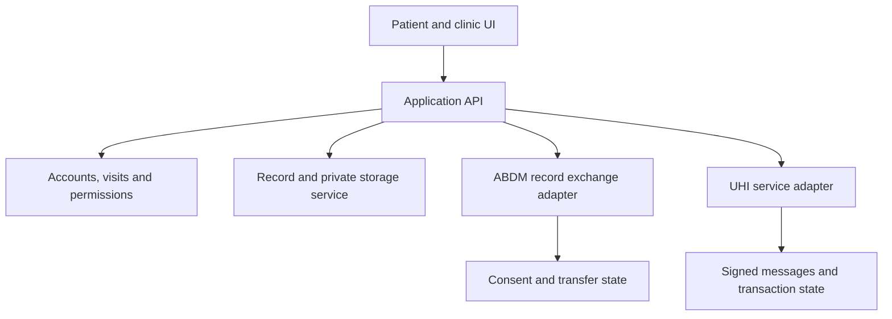

# Future product, ABDM/UHI integration and business experiments

Planning document, researched 25 October 2026. Nothing in this roadmap is implemented merely because it is described here. Commercial prices below are **illustrative experiment inputs**, not observed market prices, promises or a valuation. Detailed legal/compliance review is intentionally deferred at the owner's request; real-data pilots and paid services still need an explicit readiness decision before launch.

## 1. First choose a narrow problem and a buyer

Recommended first hypothesis: **small clinics lose staff time collecting and finding patient-provided reports before follow-up visits**. Test whether a consent-controlled pre-visit document inbox solves a frequent, costly problem.

This is a hypothesis, not completed customer research. “All healthcare needs in one app” is too broad to validate, sell and support with a small team. Uploading PDFs alone is easy to copy; reliable clinic workflow, onboarding, interoperability and support would need to become the value.

| User                | Possible pain to validate                                  | Buyer hypothesis                          | Evidence to gather                                                    |
| ------------------- | ---------------------------------------------------------- | ----------------------------------------- | --------------------------------------------------------------------- |
| Clinic receptionist | Chasing documents and matching them to visits              | Clinic owner/manager                      | Minutes spent, missing-record frequency, existing process             |
| Doctor              | Relevant historical report unavailable during consultation | Clinic owner or doctor                    | Retrieval time and repeated friction, without collecting real records |
| Patient/caregiver   | Keeping documents together across visits                   | Patient/family, or clinic sponsors access | Repeat usage, ability to find/share records unaided                   |
| Diagnostic lab      | Delivering reports and handling retrieval requests         | Lab manager                               | Delivery volume, support work, existing software constraints          |

Do not record patient identifiers or clinical files during initial discovery. Interview stakeholders with permission and keep anonymised notes. This guide does not claim those interviews have happened.

## 2. Product roadmap with exit gates

The intervals below are proposed work blocks, not delivery promises. External approvals, team time and integration access can change them substantially.

| Stage                                      | Work                                                                                                                                                                                                                                           | Evidence required before moving on                                                                                       |
| ------------------------------------------ | ---------------------------------------------------------------------------------------------------------------------------------------------------------------------------------------------------------------------------------------------- | ------------------------------------------------------------------------------------------------------------------------ |
| Learning/showcase: now                     | Read the code, reproduce both roles, complete contribution ledger, record a synthetic demo                                                                                                                                                     | Owner can explain authentication, grants, persistence and limitations without an AI script                               |
| Discovery: first 2–3 weeks of actual work  | Interview roughly 10–15 stakeholders across 3–5 clinics; observe the non-clinical document workflow; compare alternatives                                                                                                                      | Repeated pain in independent interviews and at least two clinics willing to test a narrowly defined workflow             |
| Reliability prototype: next 4–6 work weeks | Verified account lifecycle, recovery, practitioner review, per-document consent, atomic quotas, transactional mutations/outbox, indexes, migrations, private object storage, malware screening, deletion/retention, backup/restore, monitoring | Tested account isolation, restore drill, scoped privacy/security readiness and no unresolved high-impact access failures |
| Controlled pilot                           | Start with synthetic workflow trials; real records only after the separate readiness review. Add clinic/staff membership, visit-linked inbox, search/pagination and onboarding                                                                 | Staff complete the workflow unaided, repeat usage, measured retrieval improvement and a clear support owner              |
| Paid pilot                                 | Offer one transparent plan to a few suitable organisations, with defined scope/support/storage                                                                                                                                                 | Actual paid renewals and acceptable support/storage cost; signed intent is not recurring revenue                         |
| Interoperability                           | Build the appropriate sandbox adapters below, validate formats and complete the current onboarding process                                                                                                                                     | Successful sandbox scenarios and documented production approval for the actual role/service                              |
| Broader rollout                            | Tenant isolation tests, operational incident process, staffing, documented SLAs, acquisition playbook                                                                                                                                          | Retention and contribution margin justify growth; do not scale merely because the UI looks complete                      |

A clinic could say “nice project” without using or paying for it. The relevant evidence is repeated use and willingness to pay for a concrete improvement.

## 3. UHI is not the medical-record exchange API

ABDM's official developer material distinguishes **UHI for health-service discovery/delivery**, **HIE-CM for consent-based health-information exchange**, and **ABHA/registries for identity**. MediConnect currently does none of these network integrations. Its 10-character code and 24-hour grant are local application concepts, not ABHA or network consent. [S1]

| Desired future feature                                          | Likely integration track                                                 | What does not solve it                               |
| --------------------------------------------------------------- | ------------------------------------------------------------------------ | ---------------------------------------------------- |
| Discover/book a provider's service                              | UHI, with the appropriate EUA/HSPA role and service scope                | Adding a patient-code field or a static directory    |
| Request or supply clinical records across providers             | ABDM HIE-CM roles/consent flow, often HIP/HIU capabilities as applicable | Calling UHI search                                   |
| Identify/link an ABHA account or verified facility/professional | Appropriate ABDM identity/registry integrations                          | Treating self-selected doctor signup as verification |
| Represent interoperable health documents                        | NRCeS ABDM FHIR implementation guide                                     | Renaming an arbitrary JSON object or PDF as “FHIR”   |

### Track A: health records, closest to today's product

1. Decide the actual role: patient health locker/PHR workflow, provider software generating records, a requesting system, or a combination. Confirm the applicable sandbox milestones and eligibility with the current official programme; do not assume a patient upload app automatically qualifies as a clinical HIP.
2. Register through the official [ABDM sandbox](https://sandbox.abdm.gov.in/) and use the current specifications/test cases for the chosen role. Keep sandbox identities, keys, hosts and data separate from production.
3. Replace the flat “owner + filename” mental model with patient linkage, provider provenance, encounters/care contexts, structured document metadata and purpose-specific consent. An ABHA identifier would complement the local account; it does not itself grant access.
4. Build a dedicated adapter that validates incoming callbacks, handles retries/idempotency, records consent state and enforces expiry/revocation before transfers. Specify approved data types, date range, purpose and retention instead of assuming a whole-library app grant is sufficient. This is proposed architecture, not a completed implementation.
5. Use the **currently approved** NRCeS FHIR profiles and validator. `HealthDocumentRecord` is relevant to uploaded historical documents; `DiagnosticReportRecord` is relevant to diagnostic reports. Use proper metadata/provenance; do not invent lab observations from a scan or claim that storing base64 makes a file interoperable. The published profiles page inspected lists release 6.5.0; reconfirm the required version when starting integration. [S2]
6. Exercise refusal, expired/revoked consent, identity mismatch, duplicate/out-of-order callbacks, partial failure and format errors. Keep a reproducible evidence pack.
7. Complete the current functional/security/onboarding and production-access requirements for that role. Sandbox success is not production authorisation. Exact approval steps must be confirmed in the live programme rather than promised from a static roadmap.

### Track B: real UHI service discovery and booking

Start with one service and an **EUA** (patient-facing app) if the aim is discovery/booking. An HSPA represents provider services; implementing both sides multiplies onboarding and operational work. The official NHA repository describes EUA/HSP application participation and discovery/consultation use cases, but its older version labels should not be treated as the current production contract. [S3]

1. Confirm service eligibility, prerequisites and current onboarding contacts. For example, the inspected NOTTO service guide explicitly mentions HIE-CM M2 as an onboarding prerequisite; confirm requirements for the selected service rather than assuming UHI is an independent API-key signup. [S4]
2. Obtain the appropriate sandbox participant identity and register the public key/callback details. Keep private signing material server-side. Official onboarding/signing documentation covers the subscriber/key process. [S5]
3. Add a server-side UHI adapter and public HTTPS callback handlers, separate from the app's existing record routes. Persist transaction state, participant IDs, message IDs and timestamps.
4. Implement signed discovery requests and matching `on_search` responses. A search `ACK` is acceptance, **not** a finished list of results; results arrive asynchronously and must match the originating transaction/message context. Use bounded waiting and clear empty/partial-result states. [S6]
5. Build only the chosen service's supported lifecycle. The physical consultation guide describes Gateway discovery with direct EUA↔HSPA booking/fulfilment, and its April 2026 document describes pay-on-visit while online payment is under development. Confirm current capabilities before promising online checkout, refunds or a transaction-fee product. [S7]
6. Test signature failure/replay, duplicate callbacks, stale availability, provider non-response, booking conflict, cancellation and reconciliation. Never tell the patient “booked” because only an ACK arrived.
7. Follow the current UHI go-live process, demos/test cases and production participant configuration. Use approved production endpoints/keys only after approval. [S8]

### Suggested future service boundaries

This diagram describes proposed boundaries, not deployed services. Start with modules in a maintainable application; separate deployable microservices only when operational needs justify them.

## 4. Revenue models to test

Prices are deliberately labelled hypothetical. Do not put them on the live site as available plans before the product can deliver them.

| Model                                                 | Who pays / what they buy                                                                    | Example experiment, not a market quote                                                 | Main challenge / gate                                                                                                      |
| ----------------------------------------------------- | ------------------------------------------------------------------------------------------- | -------------------------------------------------------------------------------------- | -------------------------------------------------------------------------------------------------------------------------- |
| **Clinic SaaS subscription — recommended first test** | Clinic pays for staff workflow, patient document collection, visit organisation and support | Test a narrowly scoped ₹999–₹2,499/clinic/month range in interviews, then a real offer | Measurable staff time saved, repeat usage, setup/support cost and tenant isolation                                         |
| Setup, training and migration service                 | Clinic/lab pays for implementation work                                                     | Quote ₹2,000–₹10,000 once for a genuinely defined workload                             | Labour-heavy; separate one-time receipts from recurring software revenue                                                   |
| Lab report delivery/retrieval SaaS                    | Lab pays for report delivery workflow and lower support work                                | Compare a monthly plan with a volume-based proposal                                    | Existing lab systems, identity matching, delivery quality and integration effort                                           |
| White-label organisational portal                     | Clinic network or NGO pays for branded workflow and support                                 | Scope and quote a paid pilot; avoid unlimited customisation                            | Sales cycle, custom work, uptime obligations and maintaining one codebase                                                  |
| Patient/family premium                                | Family pays for optional convenience, organisation or larger storage                        | Test ₹49–₹149/family/month willingness, without an assumed conversion rate             | A free substitute may be sufficient; do not block basic data export to force payment                                       |
| B2B API/integration service                           | Software vendor pays for an actually supported integration and service level                | Development fee plus support/usage contract after interoperability competence          | Not viable while integration is only a roadmap; contracts/support are substantial                                          |
| Appointment facilitation fee                          | Patient/provider pays a transparently disclosed service charge where permitted              | Experiment only after the chosen service/network and payment capability allow it       | Booking supply, cancellations, refunds, incentives and programme terms; UHI access alone creates no commission entitlement |
| Organisational sponsorship                            | NGO/employer funds record workflow for a defined group                                      | Sponsor a bounded, consent-based pilot with a clear outcome                            | Sponsor must not receive individual records merely because it pays                                                         |
| Assisted record organisation                          | User/clinic pays for non-clinical document organisation and onboarding                      | Fixed fee for a defined task                                                           | Trust, consent, staff access and labour cost; do not turn it into unqualified clinical interpretation                      |

**Avoid building the business around selling identifiable health data or covert advertising.** It undermines the product's central trust proposition. Government incentives are not assumed revenue; scheme availability, eligibility and actual payment would need separate verification.

## 5. Basic unit economics — arithmetic, not a forecast

Illustrative monthly scenario for a hypothetical ₹1,499 clinic plan:

| Item                            | Assumption / calculation                                                                                          |
| ------------------------------- | ----------------------------------------------------------------------------------------------------------------- |
| 10 paying clinics               | 10 × ₹1,499 = ₹14,990 gross monthly recurring revenue                                                             |
| Direct servicing cost           | Hypothetically ₹400/clinic/month = ₹4,000 total, covering allocated storage/compute, messaging and support labour |
| Contribution before fixed costs | ₹14,990 − ₹4,000 = ₹10,990; about 73.3% contribution margin under those assumptions                               |
| Contribution per clinic         | ₹1,499 − ₹400 = ₹1,099/month                                                                                      |
| Acquisition cost assumption     | ₹3,000 per newly acquired clinic; about 2.7 months simple contribution payback at ₹1,099/month                    |

This excludes founder salary, fixed engineering, audits, legal/accounting, tax, payment charges where not included, refunds, churn and financing. If support consumes two hours per clinic monthly, price that labour honestly. Free hosting is not a permanent cost model. Do not claim ₹14,990 MRR until ten clinics actually pay that recurring price.

## 6. Pilot scorecard and stop conditions

Proposed validation thresholds, not completed results:

- Two independent clinics repeatedly use the narrow workflow for four weeks; track eligible visits and actual usage separately.
- Measure baseline versus pilot median record retrieval time. Aim for a meaningful improvement agreed with the clinic, rather than claiming a made-up percentage.
- Track activation, weekly active staff, records successfully matched to visits, repeat use, support minutes, cost/clinic, cancellations and willingness to renew.
- Zero tolerated unauthorised cross-patient/tenant access incidents. This is a release gate, not a claim that zero incidents can be guaranteed.
- Stop or redesign if staff consistently return to their existing method, patient matching is unreliable, or costs exceed willingness to pay.

## 7. What to build next, specifically

Priority 1: account recovery/verification, document-level consent, reliable mutations, private storage, retention and observability. Priority 2: clinic/staff roles and visit-linked document inbox after discovery confirms demand. Priority 3: the selected ABDM/UHI sandbox track. Priority 4: billing only for a validated offer. AI diagnosis, a nationwide marketplace, insurance claims and pharmacy commerce are separate products; do not add them merely to make the feature list longer.

## Official technical sources

Sources were consulted for integration concepts; the business hypotheses and proposed architecture above are our planning judgments. Some official landing pages returned access errors during direct retrieval; the indexed official material was used where available. Recheck the live documentation with the programme before implementing.

- **S1:** [ABDM UHI developer overview: UHI versus HIE-CM, identity and claims](https://docs.abdm.gov.in/docs/uhi/v1)
- **S2:** [NRCeS published ABDM FHIR profiles](https://www.nrces.in/ndhm/fhir/r4/profiles.html)
- **S3:** [NHA's open-source UHI repository](https://github.com/NHA-ABDM/UHI)
- **S4:** [NOTTO service guide and stated prerequisites](https://docs.abdm.gov.in/docs/uhi/v1/services/notto)
- **S5:** [UHI sandbox registration](https://docs.abdm.gov.in/docs/uhi/v1/getting-started/sandbox) and [signing](https://docs.abdm.gov.in/docs/uhi/v1/concepts/signing)
- **S6:** [Gateway search and asynchronous responses](https://docs.abdm.gov.in/docs/uhi/v1/api/network/endpoints/uhi-pmjay-hem/01-uhi-network-gateway-search)
- **S7:** [NHA Physical Consultation onboarding document, April 2026](https://abdm.gov.in/strapicms/uploads/Physical_Consultation_Onboarding_Document_v1_0_aba08cdb34.pdf)
- **S8:** [UHI go-live guidance](https://docs.abdm.gov.in/docs/uhi/v1/getting-started/going-live)
